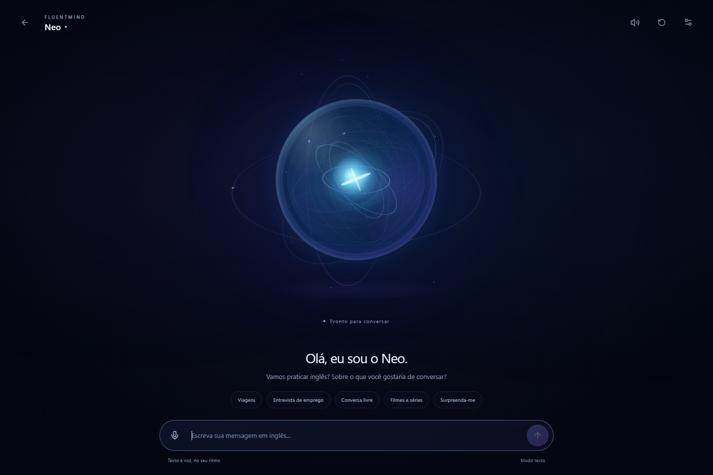
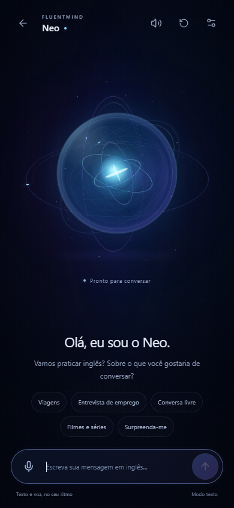

# Neo Immersive Mode

## Result and entry points

The new authenticated `/neo` route is a presentation mode outside the dashboard
layout. It is available through **Neo imersivo** in the navigation and through
the orbit icon in `/conversar`. The previous text conversation and learning
chatbot remain available. The back control returns to the previous route, or
to `/conversar` when opened directly. Existing settings are linked from the header.

Previews use an isolated local fixture with no real account data.

## Initial codebase findings

- `SimpleConversation.jsx` contained the existing text/voice conversation flow.
- `Chatbot.jsx` provides the separate learning interface, permanent conversation
  services and MindBlock/correction workflows. Those contracts were not changed.
- `/api/chat` returns a complete JSON response. There is no text response stream
  to preserve in this flow; captions update as soon as the real reply arrives.
- `useRecorder` uses MediaRecorder, explicit microphone permission and bounded
  recordings. `speech.js` sends the recording to the existing transcription API.
- `/api/transcribe` handles both STT and TTS, including the existing ElevenLabs
  integration. No additional speech service was introduced.
- The simple flow keeps up to 100 messages in account-scoped sessionStorage and
  sends recent context to the API. Both presentations now share this state and
  also preserve unsent drafts when switching modes.
- `ProtectedRoute` and `AuthProvider` retain authentication and account boundaries.
- React, Lucide icons and scoped CSS/SVG are sufficient. No new package, WebGL
  framework, image-generation dependency or database migration was needed.

## Files and components

| File | Responsibility |
| --- | --- |
| `src/pages/NeoImmersive.jsx` | Fullscreen presentation, greeting/topics, one-line composer, captions, retries and navigation |
| `src/pages/neo-immersive.css` | Scoped scene, glass sphere, orbital layers, responsive controls and motion policies |
| `src/components/NeoCore.jsx` | Decorative pseudo-3D core, state styling and bounded DOM updates for audio intensity |
| `src/hooks/useConversation.js` | Existing conversation logic extracted for both presentations; text, audio, session cache, drafts, cancellation and retries |
| `src/hooks/useAudioMeter.js` | Browser-local Web Audio input/output amplitude, sampling and cleanup |
| `src/hooks/useImmersiveEnvironment.js` | Page visibility, reduced motion, modest-device hints and visual viewport handling |
| `src/hooks/useRecorder.js` | Optional stream lifecycle observers, preserving existing recorder behavior |
| `src/pages/SimpleConversation.jsx` | Existing presentation consuming the shared hook, plus entry to immersive mode |
| `src/App.jsx`, `src/data/navigation.js`, `src/layout/Layout.jsx` | Protected route and navigation entry |
| `src/pages/__tests__/neoImmersive.test.jsx` | Presentation and interaction regression tests |
| `src/hooks/__tests__/useAudioMeter.test.js` | Actual sample math, graph routing, timeout fallback and cleanup tests |

The AI prompts, pedagogical behavior, provider models, API request/response
contracts, permanent learning history and authorization rules were not modified.

## State behavior

| State | Trigger and visual behavior |
| --- | --- |
| IDLE | Ready, with slow breathing and orbital motion |
| LISTENING | Actual MediaRecorder capture; input analyser controls amplitude |
| PROCESSING | Permission request, STT, chat response or TTS preparation; accelerated inner orbits |
| SPEAKING | Audio playback has actually started; output analyser controls amplitude |
| ERROR | Recording, network or playback failure; restrained color shift and contextual retry |
| MUTED | Output explicitly disabled; no automatic TTS and a dimmer active core |

Capture/processing take visual priority over MUTED, so an active microphone is
always indicated. The volume button still identifies the output mute setting.
Metering failures use a labeled **Movimento ambiente** fallback, without claiming
audio synchronization. Metering never sends captured samples to another service
and never connects the microphone to the speakers.

## Interaction and accessibility

- No automatic microphone activation. Recordings can be stopped, sent or canceled.
- Voice turns do not automatically focus the text field/open the keyboard.
- Text uses a native single-line input with horizontal editing, Enter to send,
  IME composition protection and an accessible label.
- Initial topic chips disappear once interaction starts.
- Captions use a polite live region, readable contrast and a scrollable region
  for long replies. Their visibility period scales with the real word count.
  Focus or pointer interaction holds captions open; last speech can be recalled.
- Failed drafts are retained. TTS retry repeats only speech generation, not the
  chat request. Network requests, media tracks and playback are canceled on exit.
- Visible keyboard focus and labeled touch controls are provided.
- `dvh`, VisualViewport events and container-relative size limits keep the core
  and composer inside the available viewport, including short layouts.

## Performance and validation

- No new dependencies. The core uses CSS transforms, gradients and a small SVG.
- Audio sampling is bounded to roughly 30 Hz and stored in refs, avoiding React
  renders per audio frame. Core DOM updates are capped at 30 Hz, or 15 Hz for
  modest devices. Audio contexts are closed and frames canceled on cleanup.
- Modest devices/save-data mode receive six rather than sixteen particles and
  fewer animated layers. Hidden pages pause animations and sampling.
- Reduced motion disables scene animations and reactive scaling.
- A suspended/unavailable AudioContext cannot indefinitely block normal playback;
  metering falls back without rerouting the media element through a blocked graph.
- ESLint passed; the automated project tests and production build passed.
- Chrome checks used simulated capture and locally generated WAV playback,
  without accessing a physical microphone or calling paid providers. Both
  LISTENING and SPEAKING reported real analyser data and varying amplitude.
- Initial and conversation layouts passed overflow/core/control checks at
  320×568, 390×844, 390×400, 844×390, 820×1180 and 1440×960.
- Reduced motion and hidden-page checks each reported zero running animations.
- No browser JavaScript exceptions were observed.
- One 61-frame sample in headless Chrome with GPU disabled averaged 19.72 ms
  per frame (about 51 FPS). This is a software-rendered local sample, not a
  guarantee of 60 FPS across physical devices.

## Limits and delivery scope

- The pasted request described a reference image but did not include that image.
  The energy-core option was implemented using native CSS/SVG.
- Streaming captions are not fabricated; the current backend supplies complete
  JSON replies. No streaming API contract was introduced in this presentation work.
- Conversation/draft persistence retains the existing per-account, per-tab scope;
  it was not expanded to permanent cross-device history.
- Live ElevenLabs speech and physical Android/iOS microphone/keyboard behavior
  require validation with the user's configured account and devices.
- Published on 2026-10-31 after the user's deployment request. Production URL:
  https://project-r80py.vercel.app/neo
- Vercel deployment: `dpl_CQK4FJdteQWdXugw3g8MuTUmDihj`, status Ready.
  `/neo`, `/conversar` and `/app` returned HTTP 200; the published bundle contains
  the immersive presentation and correct Supabase target. Chat and transcription
  endpoints rejected unauthenticated requests with HTTP 401.
- The production smoke test did not exercise paid provider generation or a
  physical microphone.
